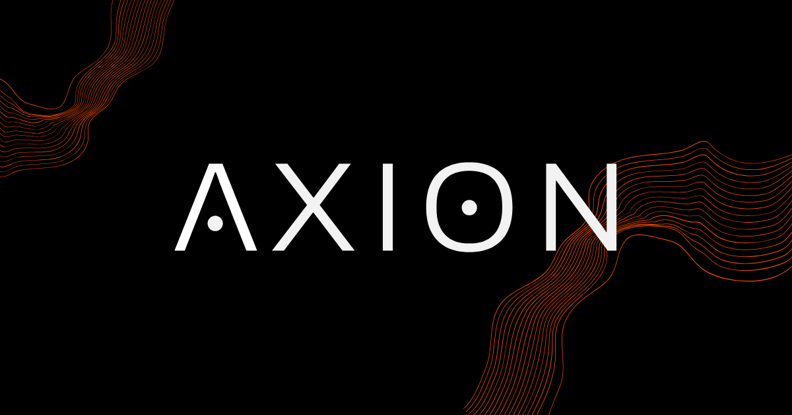

<p align="center" style="padding-top: 40px; padding-bottom:40px;">
  
</p>

<p align="center">
  
  
  
  
</p>

Bem-vindo ao repositório de backend do **Axion** — uma plataforma aberta de trilhas de estudo para autodidatas.

> Para uma visão geral do projeto, acesse o [hub oficial](https://github.com/genzo-dev/axion_hub).

## Qual o propósito desse repositório?

Este repositório é responsável pelo backend do **Axion**, incluindo as documentações relacionadas especificamente ao backend como mapeamento de endpoints, módulos, entre outros.

## Stack

| Ferramenta                                    | Versão             |
| --------------------------------------------- | ------------------ |
| [NestJS](https://nestjs.com/)                 | ^11.0.1            |
| [TypeScript](https://www.typescriptlang.org/) | ^5.7.3             |
| [PostgreSQL](https://www.postgresql.org/)     | 17 (imagem Docker) |
| [TypeORM](https://typeorm.io/)                | ^1.0.0             |
| [Docker](https://docs.docker.com/)            | -                  |
| [Jest](https://jestjs.io/pt-BR/)              | ^30.0.0            |

## Como rodar o projeto:

> [!IMPORTANT]
>
> Requisitos:
>
> - Docker
> - Docker Compose

O projeto está dividido em três ambientes (desenvolvimento, testes e staging), abaixo estão as informações de como rodar cada um deles:

### Ambiente de Desenvolvimento

#### 1. Copie as variáveis de ambiente de desenvolvimento:

```bash
cp .envs/.env.dev-EXAMPLE .envs/.env.dev
```

#### 2. Rode o projeto via docker compose:

```bash
npm run docker:dev
```

### Ambiente de Testes

#### 1. Copie as variáveis de ambiente de testes:

```bash
cp .envs/.env.test-EXAMPLE .envs/.env.test
```

#### 2. Rode o projeto via docker compose:

```bash
npm run docker:test:e2e
```

#### Para rodar os testes unitários, utilize:

```bash
npm run test
```

### Ambiente de Staging

#### 1. Copie as variáveis de ambiente de staging:

```bash
cp .envs/.env.staging-EXAMPLE .envs/.env.staging
```

#### 2. Rode o projeto via docker compose:

```bash
npm run docker:staging
```

> [!NOTE]
>
> Os comandos sobem apenas o contêiner app e o postgres. Para ver logs completos, use `docker compose logs -f app`.

## Estrutura de pastas:

```bash

axion-backend/
├── Dockerfile                          # Build multi-stage (development, build, staging)
├── docker-compose.yml                  # Configuração base dos serviços
├── docker-compose.dev.yml              # Override para desenvolvimento
├── docker-compose.staging.yml          # Override para staging
├── docker-compose.test.yml             # Override para testes e2e
├── package.json
├── nest-cli.json                       # Configuração do CLI NestJS
├── tsconfig.json                       # Configuração principal do TypeScript
├── tsconfig.build.json                 # Configuração de build do TypeScript
├── eslint.config.mjs                   # Configuração do ESLint (flat config)
├── .prettierrc                         # Configuração do Prettier
│
├── src/                                # Código fonte da aplicação
│   ├── main.ts                         # Entrypoint da aplicação NestJS
│   │
│   ├── app/                            # Módulo raiz da aplicação
│   │   ├── app.module.ts               # Módulo principal (importa TypeORM, Config, etc.)
│   │   ├── app.controller.ts           # Controller raiz (GET /)
│   │   ├── app.controller.spec.ts      # Teste unitário do controller raiz
│   │   ├── app.service.ts              # Service raiz
│   │   ├── app.config.ts               # Configuração de variáveis de ambiente
│   │   └── config/
│   │       └── app.configuration.ts    # Configurações globais (pipes, CORS, etc.)
│   │
│   ├── modules/                        # Módulos de negócio da aplicação
│   │   └── user/                       # Exemplo: módulo de usuário (a ser criado)
│   │       ├── user.module.ts
│   │       ├── user.controller.ts
│   │       ├── user.service.ts
│   │       └── user.entity.ts
│   │
│   └── common/                         # Recursos compartilhados entre módulos
│       ├── decorators/                 # Decoradores personalizados
│       ├── guards/                     # Guards de autenticação/autorização
│       ├── interceptors/               # Interceptadores (logs, transformação)
│       └── filters/                    # Filtros de exceção (tratamento de erros)
│
├── test/                               # Testes e2e da aplicação
│   ├── app.e2e-spec.ts                 # Teste e2e da rota raiz
│   └── jest-e2e.json                   # Configuração do Jest para e2e
│
├── docs/                               # Documentação do projeto
│   ├── setup.md
│   ├── modules.md
│   ├── endpoint-map.md
│   └── entities.md
│
├── .envs/                              # Variáveis de ambiente (copiar .*-EXAMPLE para .*)
│   ├── .env.dev-EXAMPLE
│   ├── .env.staging-EXAMPLE
│   └── .env.test-EXAMPLE
│
└── dist/                               # Código compilado (gerado pelo build, gitignored)

```

> [!NOTE]
>
> **Observação:** modules/ e common/ ainda não existem — estão mapeados como estrutura futura conforme os módulos forem criados.

## Documentação:

A documentação detalhada do backend está em [`docs/`](docs/):

| Documento                               | Descrição                                                                   |
| --------------------------------------- | --------------------------------------------------------------------------- |
| [setup.md](docs/setup.md)               | Pré-requisitos, configuração de ambientes e instruções para rodar o projeto |
| [modules.md](docs/modules.md)           | Mapeamento dos módulos da aplicação, dependências e responsabilidades       |
| [entities.md](docs/entities.md)         | Entidades do banco de dados, campos, relacionamentos e índices              |
| [endpoint-map.md](docs/endpoint-map.md) | Lista de endpoints da API com métodos, parâmetros e respostas               |

> [!NOTE]
>
> Essa seção será atualizada conforme o crescimento do projeto

## Repositórios relacionados

| Repositório                                                   | Função                 |
| ------------------------------------------------------------- | ---------------------- |
| [axion_hub](https://github.com/genzo-dev/axion_hub)           | Hub central do projeto |
| [axion-docs](https://github.com/genzo-dev/axion-docs)         | Documentação geral     |
| [axion-frontend](https://github.com/genzo-dev/axion-frontend) | Aplicação frontend     |

## Autor

<div align="center">
  
</div>

<div align="center">
  <strong>Gabriel Enzo (genzo-dev)</strong>
</div>

<div align="center">
  <sub>Fullstack web developer</sub>
</div>

&nbsp;

<div align="center">
  <a href="https://www.linkedin.com/in/genzo-dev/">💼 LinkedIn</a>
  |
  <a href="https://github.com/genzo-dev">🐙 GitHub</a>
</div>
